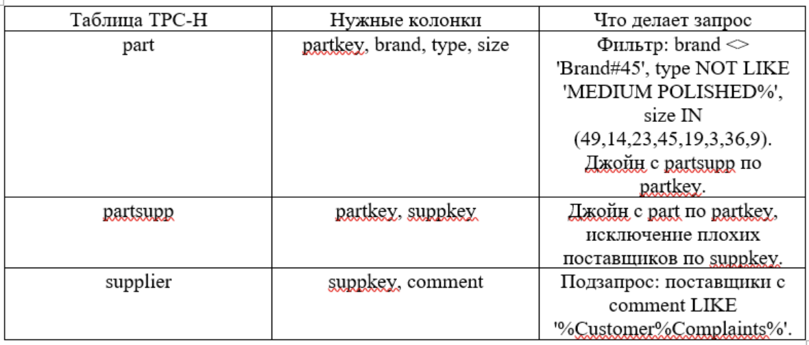
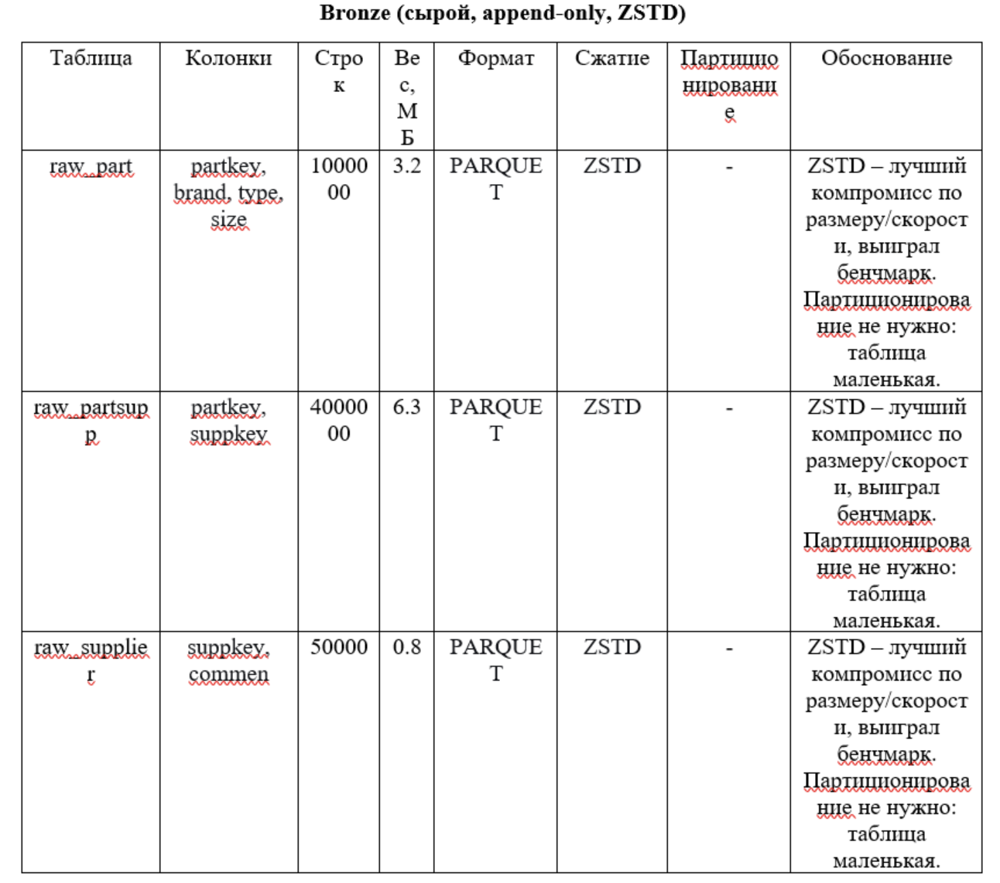
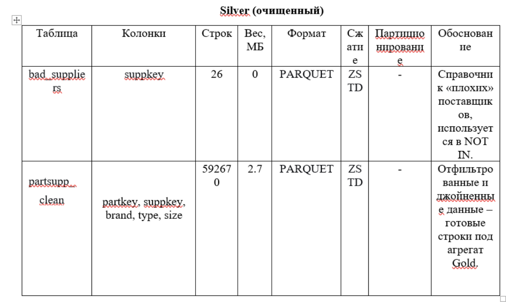
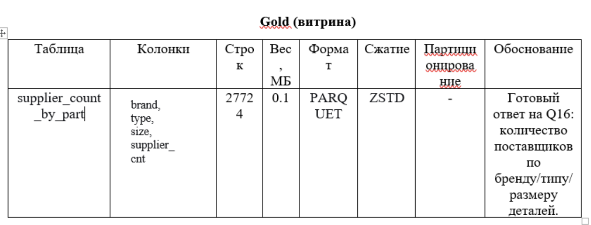
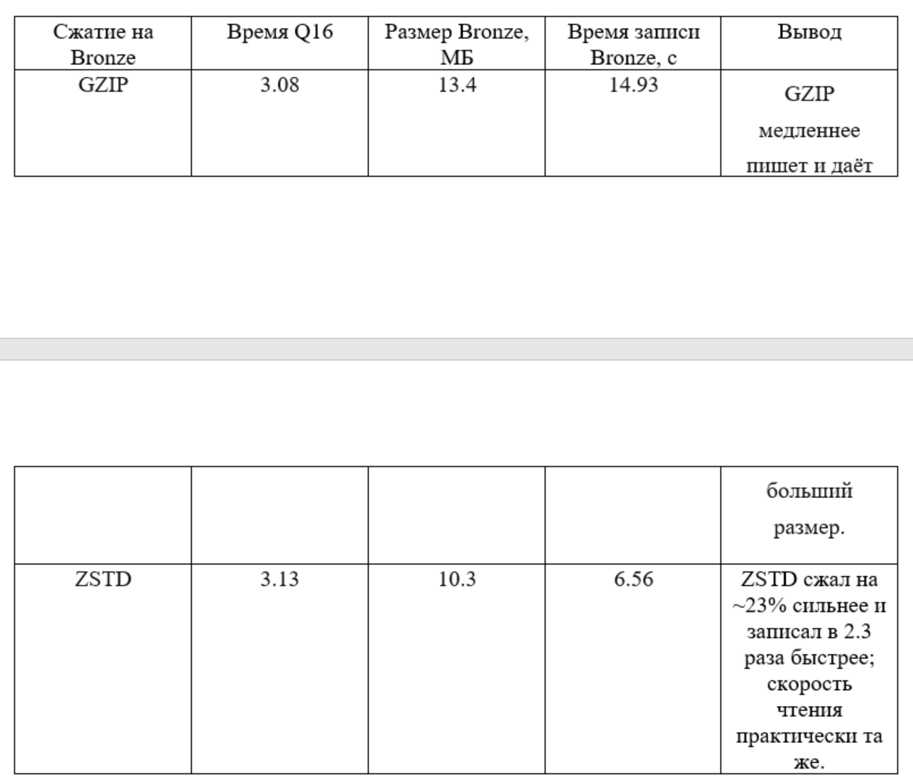
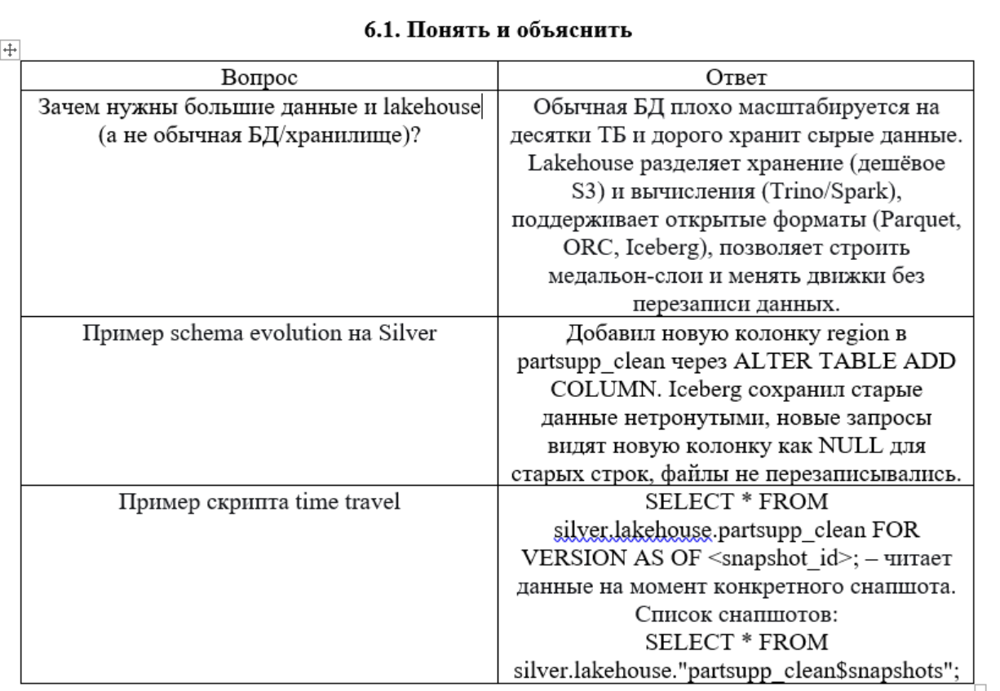
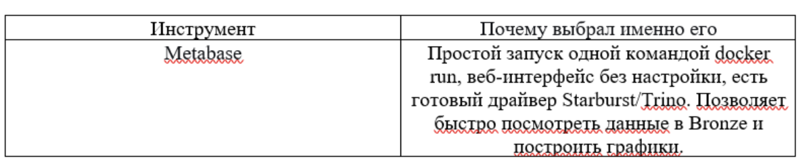
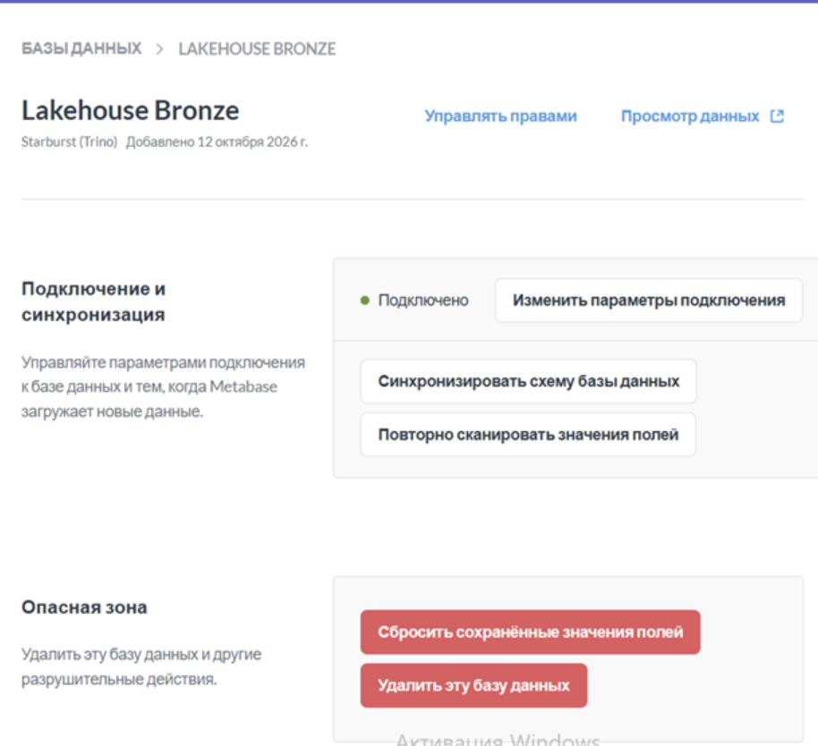

### 3. Какие данные нужны

### 4. Медальон – решения по каждому слою

### 5. Тесты производительности

## Часть 2 — осмысление и работа с инструментами
### 6.1. Понять и объяснить

### 6.2. Подключить инструмент к lakehouse

Скрин, подтверждающий успешное подключение:

### Вывод по практической работе №1
В работе я собрал локальный Lakehouse (MinIO -> Lakekeeper -> Trino) и реализовал полный медальон под TPC-H Q16. Убедился, что правильное разделение на слои даёт гибкость: из сырых part/partsupp/supplier получается компактная витрина на 27 724 строки, а сверка Gold с Q16 напрямую показала совпадение (27 724 строки, сумма 592 541). Бенчмарк форматов показал, что ZSTD лучше GZIP по размеру и скорости записи при той же скорости чтения, поэтому именно его выбрал для Bronze. Metabase поверх Bronze показал, что lakehouse легко подключается к BI-инструментам без экспорта данных: данные остаются в S3, а движок отдаёт их по SQL. В итоге получил практическое понимание компромисса между размером, скоростью, стоимостью.